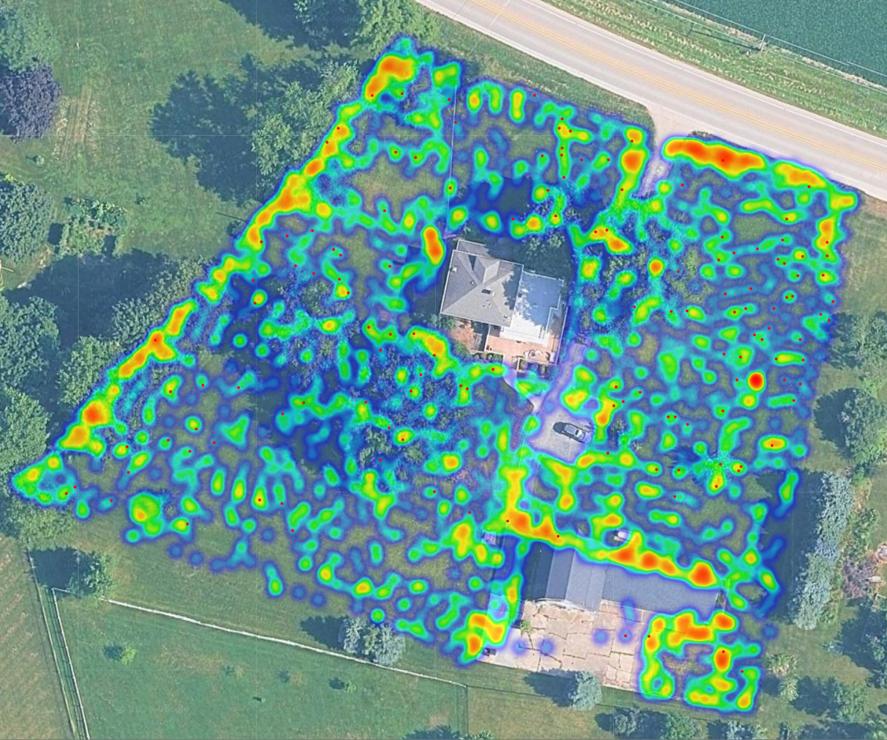

# Lawn Bounce Heatmap



**Find the bumps in your lawn using the phone in your pocket.**

Every time I mowed, my John Deere Z530R zero-turn banged and bounced across the yard. Every jolt is wear on the mower's suspension and frame, and on the operator's back. I wanted to fix the lawn instead of replacing parts. The problem was that from the seat, the whole yard feels rough. I couldn't tell where the real trouble spots were.

So I measured it. I recorded g-force and GPS with a free phone app while I mowed. Then this script turned about an hour of data (373,000 rows) into a heatmap over satellite imagery of my property. The bumps turned out to cluster in a few areas, which meant I could make targeted repairs instead of regrading the whole yard.

This repo lets you do the same for your own property.

<!-- Add a screenshot of your map here, e.g.  -->

> **Privacy note:** Your recordings and the maps they generate contain the GPS location of your home. The included `.gitignore` keeps `*.csv` and `*.html` files out of your repo, so don't force-add them. The only CSV tracked here is synthetic sample data.

---

## What you need

- **An Android phone or iPhone** with the free [Physics Toolbox Sensor Suite](https://play.google.com/store/apps/details?id=com.chrystianvieyra.physicstoolboxsuite) app by Vieyra Software. It's also on the iOS App Store.
- **A mower, tractor, or anything else you drive over your lawn.**
- **Python 3.9 or newer** on your computer.
- **An internet connection** when you open the map, so the satellite imagery can load.

---

## Step 1: Record your mowing session

Menu names can shift slightly between app versions, but the flow is the same.

1. **Install and open** Physics Toolbox Sensor Suite.
2. **Open Multi Record** from the app's menu. This mode records several sensors into a single file.
3. **Turn on the G-Force Meter and GPS.** These two are required. Linear Accelerometer, Gyroscope, and Inclinometer are optional extras the script ignores.
4. **Allow location access** when the app asks. Set your phone's location mode to high accuracy if it has that option.
5. **Wait for a GPS fix** before you start. Give it 30 to 60 seconds outside, until latitude and longitude show real numbers instead of zeros.
6. **Secure the phone in one fixed spot.** A phone mount, a zipped chest pocket, or a cup holder wedged with a towel are all options. A phone sliding around in a loose pocket adds noise, so keep it in the same place for every recording you want to compare.  Personally I mounted a phone to a cinder block using zip ties with the cinder block secured to the base of the zero turn using straps.  
7. **Keep the screen awake.** Turn off auto-lock for the session, or check the app's settings, so the phone doesn't stop recording when the screen sleeps.
8. **Tap record** and mow normally. A steady speed and overlapping passes give the most even coverage.
9. **Tap stop** when you're done, and save the recording.
10. **Export the CSV.** Use the app's share or export option to send it to Google Drive, email, or your computer.

### What the CSV looks like

The script needs these columns (exact names can vary slightly by app version):

| Column | Meaning |
|---|---|
| `gFx`, `gFy`, `gFz` | G-force on each axis of the phone, in multiples of gravity |
| `Latitude`, `Longitude` | GPS position |
| `Speed (m/s)` | GPS speed. Optional, used by `--min-speed` |

Rows recorded before the GPS gets a fix show up as `0,0`. The script drops them automatically.

---

## Step 2: Install Python dependencies

```bash
git clone https://github.com/VincentLucius79/lawn_bounce_heatmap.git
cd lawn_bounce_heatmap
python -m venv .venv
```

Activate the environment:

```bash
# macOS / Linux / WSL
source .venv/bin/activate
```

```powershell
# Windows PowerShell
.venv\Scripts\Activate.ps1
```

Then install the dependencies:

```bash
pip install -r requirements.txt
```

---

## Step 3: Generate your map

Try it first with the included sample data:

```bash
python lawn_bounce_heatmap.py sample_data/sample_mowing.csv -o sample_map.html
```

Then run it on your own recording:

```bash
python lawn_bounce_heatmap.py my_mowing.csv -o my_lawn.html --hotspots worst_spots.csv
```

You'll see a short summary like this:

```
Rows used:            366,670 (plotted 3,000)
Typical bounce:       1.06 g (median)
Hardest hit:          4.63 g
Red-dot threshold:    1.77 g  (150 dots)
Saved map:            my_lawn.html
Saved hotspots:       worst_spots.csv
```

### Options

| Option | Default | What it does |
|---|---|---|
| `-o`, `--output` | `bounce_heatmap.html` | Name of the map file to create |
| `--sample` | `3000` | Number of random rows to plot. Use `0` for every row (denser map, bigger file) |
| `--top-pct` | `95` | Percentile cutoff for red "worst bump" dots. `95` marks the worst 5% |
| `--min-speed` | `0` | Drops rows slower than this, in m/s. `0.3` removes time spent sitting still |
| `--lawn-fraction` | `0.5` | How much of the screen your mowed area fills when the map opens |
| `--basemap` | `google` | Satellite imagery source: `google` or `esri` |
| `--max-native-zoom` | `20` | Deepest real imagery level. Lower it to `19` if tiles turn gray when you zoom in |
| `--hotspots` | off | Also saves the red-dot locations and bounce values to a CSV |
| `--seed` | `42` | Random seed, so the same command always produces the same map |

---

## Step 4: View the heatmap over your property

You don't need to enter an address or coordinates. The script reads the GPS positions in your recording and centers the satellite view on wherever you mowed.

1. **Open the HTML file** in any web browser. Double-clicking it usually works.
2. **Look at the heat layer.** Brighter, hotter colors mean a rougher ride in that spot.
3. **Click a red dot** to see its bounce value in g.
4. **Zoom in** with the scroll wheel or the +/- buttons. The map zooms past the point where the satellite imagery runs out, and enlarges the last available tiles instead.
5. **Toggle layers** with the control in the top-right corner to compare the heatmap with the bare imagery.
6. **Take it outside.** Open `worst_spots.csv` on your phone, or paste a coordinate into Google Maps, to walk straight to a problem area.

**About the imagery:** The `google` basemap loads tiles directly from Google's map servers. That isn't an officially supported Google API, so it's best kept to personal, non-commercial use. The `esri` option uses Esri's World Imagery service and includes the required attribution. Imagery detail varies by location for both, so try the other one if your property looks blurry.

---

## How it works

1. **Bounce is total g-force.** For every row, the script computes

   ```
   bounce = √(gFx² + gFy² + gFz²)
   ```

   This is the overall force on the phone in multiples of gravity. A phone sitting still reads about **1.0 g**, and every jolt pushes the number higher. Combining all three axes means the number doesn't depend on how the phone is oriented.

2. **The heatmap is log-scaled.** Each point's heat weight is `log(1 + bounce)`. Taking the log compresses large values, so a few huge spikes don't drown out the steadily rough patches.

3. **A random sample keeps the map fast.** By default, 3,000 random rows are drawn. That's enough to show the pattern while keeping the HTML file small. Use `--sample 0` for every row.

4. **Red dots mark the worst hits.** Points at or above the 95th percentile of bounce, meaning the worst 5%, get a clickable red dot.

5. **The map frames your lawn automatically.** The view fits the bounds of your GPS data plus padding, so the mowed area fills about half the screen when the map opens.

---

## Limitations and tips

- **GPS accuracy:** Phone GPS is usually accurate to within a few meters. Treat hot spots as *areas* to inspect, not exact points.
- **Speed matters:** Hitting the same bump faster produces a bigger jolt. For fair before/after comparisons, mow at a similar speed each time.
- **Phone placement matters:** Readings from a fixed mount and from a shirt pocket aren't directly comparable. Pick one spot and stick with it.
- **GPS updates slowly:** The accelerometer logs many readings per second, but GPS updates about once a second. Many rows share the same location, which is normal.

## Using the results

1. Walk the red-dot clusters and figure out what's causing them: dips, ruts, roots, mole tunnels, or drainage washouts.
2. Fix the worst areas first. Topdressing and leveling compound work well for shallow dips.
3. Record again after the fix, at the same speed and with the phone in the same spot.
4. Compare the two maps. If the hot zones cooled down, the repair worked.

## Ideas for future work

- Normalize bounce by speed
- Generate side-by-side before/after comparison maps
- Cluster hotspots automatically, for example with DBSCAN
- Track bounce over a season as a rough proxy for wear on the mower

## About the sample data

`sample_data/sample_mowing.csv` is **synthetic**. It was generated to imitate back-and-forth mowing passes over Central Park's Great Lawn in New York, with three simulated bumpy patches and GPS jitter. It isn't a real recording. It's there so you can try the script before collecting your own data.

## License

MIT. See [LICENSE](LICENSE).
